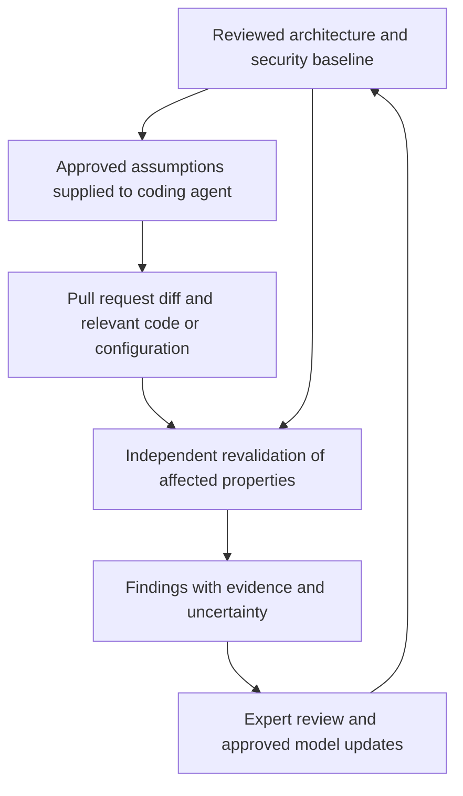

# Continuous Threat Modeling for Distributed Architectures

An AI proof of concept exploring how code changes can be connected to an existing threat model so developers and security reviewers can identify security assumptions that need revalidation.

**Status:** Early, offline proof-of-concept exploration supporting a talk submission. Live CI integration and reliable review across multiple repositories remain project goals. This repository documents the technical design and preliminary exploration.

## Why this project exists

A threat model captures a system at a particular point in time. As services, repositories, and deployment configurations change, its assumptions can become outdated. A pull request might remove an authentication check, expose an internal endpoint, or change how credentials are handled while the application continues to function.

These changes are particularly difficult to assess when a security property depends on several services. The project explores how AI could help maintain the reasoning behind a threat model as software evolves.

## Core approach

Start with a reviewed data flow diagram (DFD), trust boundaries, threats, controls, and assumptions. Translate important assumptions into checkable security properties, called **invariants**, and revalidate affected properties against relevant changes and supporting evidence.

For example, an endpoint may be required to authenticate every request. Removing its authentication check should trigger review of the associated threat, even if the architecture diagram's components and connections stay the same.

The proposed system would preserve security reasoning and review history in a shared model across repositories.

## Proposed workflow

1. **Establish a baseline:** Record the architecture, trust boundaries, threats, assumptions, and supporting code evidence.
2. **Provide context before coding:** Supply relevant approved security assumptions to the coding agent at session start.
3. **Collect change context:** Gather the pull request diff and relevant code or configuration through a repository integration.
4. **Revalidate independently:** Check affected assumptions, follow dependencies across services, and flag new architecture requiring threat analysis.
5. **Review and update:** Present evidence, route uncertain or significant changes to a reviewer, and version approved updates to the threat model.

## Intended reviewer output

Each review should explain what changed, which assumptions are affected, what evidence supports the finding, and what response is required. Each checked property would receive one of four outcomes:

| Outcome | Meaning |
| --- | --- |
| Holding | Available evidence supports the property for the reviewed change. |
| Violated | Available evidence indicates that the property no longer holds. |
| Unknown | Evidence is missing or insufficient to reach a conclusion. |
| No longer applicable | The property no longer applies to the changed system and needs review. |

Missing evidence and uncertainty remain visible for expert review.

## Security frameworks

Security domain experts guided how the following frameworks informed the proof of concept:

| Framework | Role |
| --- | --- |
| MITRE ATT&CK | Ground threat scenarios in observed attacker behavior, including credential access, movement between systems, and data extraction. |
| Adam Shostack's Four Question Framework | Structure understanding of the system, what can go wrong, possible responses, and evaluation of those responses. |
| STRIDE | Guide review of spoofing, tampering, repudiation, information disclosure, denial of service, and elevation of privilege. |
| Adam Shostack's PHANTOM-B | Explore LLM-specific risks, including prompt injection, hallucination, anthropomorphization, non-explainability, training issues, overreliance, missing security engineering, and bias. |

These frameworks inform review questions and threat scenarios. Findings still require evidence from the system being modeled; their use does not establish complete threat coverage or automated mapping to every technique.

## Preliminary exploration

The initial offline exploration examined:

- **WordPress commit history:** Architecture and credential-handling changes.
- **Infisical:** Changes to service-token assumptions.

The evidence is preliminary. A reproducible pilot with independently reviewed examples is the next step.

## Contribution and collaboration

I supported security domain experts preparing a talk submission on continuous threat modeling. As the AI engineer, I was responsible for translating their guidance into the AI workflow and proof-of-concept implementation.

The experts guided the security approach and clarified the architecture, threats, assumptions, and supporting evidence the prototype needed to consider.

## Next steps

- Build a reproducible pilot with a fixed evaluation prompt and independently reviewed examples.
- Measure missed changes, false alerts, incomplete analysis, review time, and cost.
- Develop live CI integration and evaluate review across multiple repositories.

## Technical design

See [Continuous Threat Modeling Technical Design](./Continuous_Threat_Modeling_Technical_Design_Final.docx) for the project scope, proposed workflow, expert guidance, and proof-of-concept progress.
